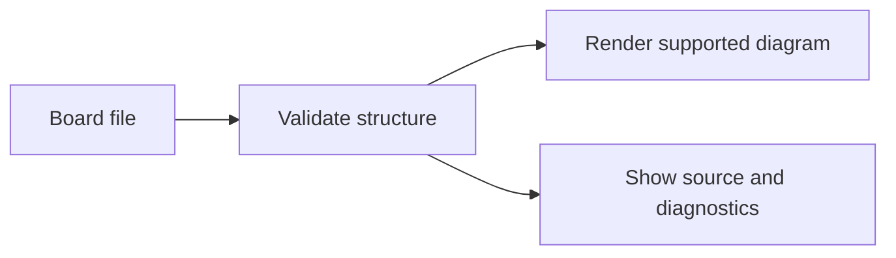
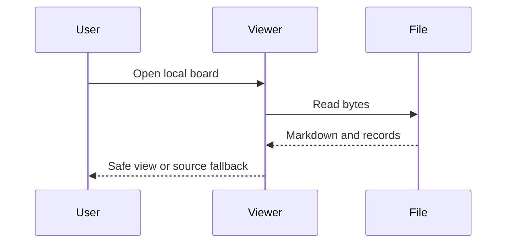

---
{
  "format": "envi-whiteboard",
  "version": 0,
  "id": "board-reader-demo",
  "roots": {
    "repo": {
      "kind": "git"
    }
  },
  "x-example-only": true
}
---

<!-- wb:id title -->
# File-first board viewer

<!-- wb:id overview -->
## Overview

<!-- wb:id rationale -->
A board is a local review document, not a running agent or a spatial drawing.
Its original text remains authoritative when rendering is unavailable.

<!-- wb:id design -->
## Design

<!-- wb:id diagram-pipeline -->


The second view shows an explicit user open; file changes never send an agent prompt.

<!-- wb:id diagram-open -->


<!-- wb:id evidence -->
## Source evidence

This pin names actual committed dotfiles lines. It illustrates the reference
contract only; those lines do not implement this proposed viewer. Bind `repo`
to the intended dotfiles checkout explicitly to resolve it.

<!-- wb:id source-options -->
```wb-source
{
  "root": "repo",
  "path": "nvim/lua/config/options.lua",
  "commit": "b06b1cc8418be248987652f2180e9557a72d6948",
  "lines": {
    "start": 5,
    "end": 6
  },
  "label": "Existing clipboard option; evidence pin, not board implementation"
}
```

<!-- wb:id discussion -->
## Discussion

These example identities are labels, not authenticated participants.

<!-- wb:id thread-fallback -->
```wb-thread
{
  "anchor": {
    "target": "diagram-pipeline",
    "baseSha256": "5d5d079c030754c8a1e9d3d8a896daba47daf743b93bf02101be7af4b6ee2e9c",
    "quote": {
      "exact": "Parse --> Source[Show source and diagnostics]"
    }
  },
  "status": "open",
  "messages": [
    {
      "id": "question",
      "author": "reviewer-demo",
      "body": "Does unsupported diagram syntax remain readable?"
    },
    {
      "id": "reply",
      "author": "agent-demo",
      "body": "Yes. The viewer retains the original Mermaid source and a visible diagnostic."
    }
  ]
}
```
